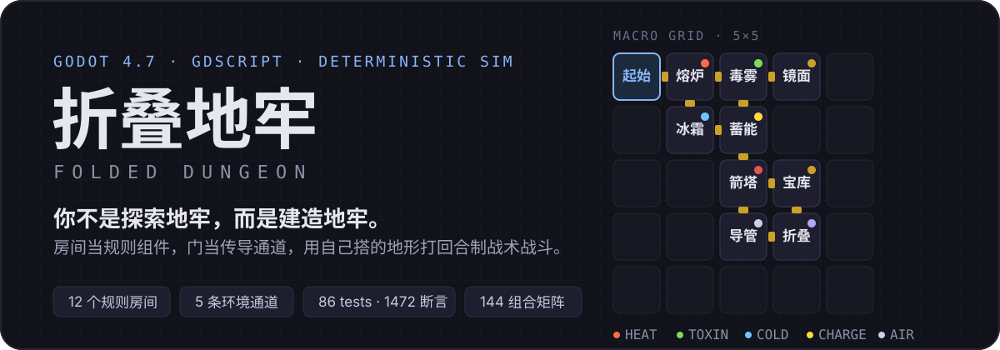
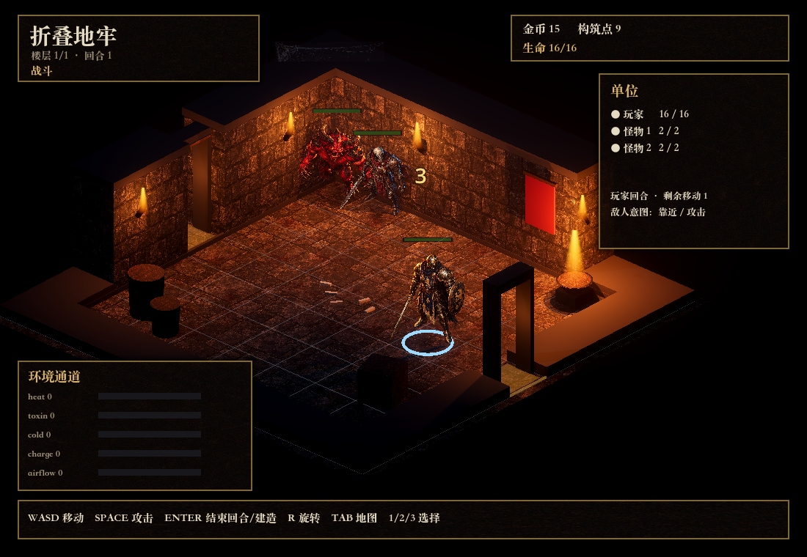
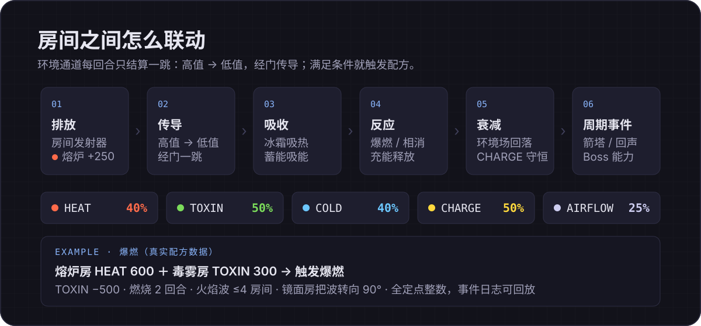

<p align="center">
  <a href="./assets/readme/hero.svg"></a>
</p>

<p align="center">
  <a href="https://github.com/ruijayfeng/folded-dungeon/actions/workflows/test.yml"></a>
  <a href="./LICENSE"></a>
  
  
</p>

<p align="center">
  <b>2D 俯视角 · 回合制战术 · 空间构筑 · Roguelike</b><br/>
  <sub>可玩原型 · 12 个规则房间 · 5 条环境通道 · 86 tests / 1472 assertions</sub>
</p>

---

## 这是什么

**《折叠地牢》是一个"建造地牢"的肉鸽原型：别人进入地牢找宝藏，你建造地牢，让它成为武器。**

你在一层里从起始房向外扩建，把「熔炉 / 毒雾 / 冰霜 / 镜面 / 重力」等规则房间当作组件，用门把它们连成环境通道，再用自己搭出来的规则地形打回合制战术战斗。

- **房间 = 规则组件**：排放、传导、吸收，满足条件就触发反应配方；
- **门 = 传导通道**：相邻房间的门对齐后才连通，环境值一跳一跳地传；
- **5×5 网格 = 战术装置**：放置 / 旋转 / 替换，构筑点有限，形状和顺序都得算。

> 完整设计推导见 [`docs/01-设计理解与系统拆解`](docs/01-设计理解与系统拆解.md)、[`docs/02-补全设计与待确认清单`](docs/02-补全设计与待确认清单.md)；本文只回答"能玩什么、怎么跑起来"。

## 现在能玩到什么

| 内容 | 说明 |
|---|---|
| **12 个规则房间** | 熔炉 / 毒雾 / 冰霜 / 风暴 / 镜面 / 重力 / 蓄能 / 回声 / 导管 / 箭塔 / 宝库 / 折叠 |
| **5 条环境通道** | HEAT / TOXIN / COLD / CHARGE / AIRFLOW：一跳传导 + 3 个反应配方（爆燃 / 冷热相消 / 充能释放） |
| **回合制战术战斗** | 玩家阶段 → 怪物追击 → 环境结算；击退撞墙、燃烧 / 中毒 / 冰冻、Boss 房间能力 |
| **完整单局循环** | 蓝图 3 选 1 → 构筑 → 探索穿门 → 战斗 / 事件 / 休整 / 商店 → 奖励 → Boss → 结算 |
| **可玩 GUI 运行层** | 主场景 `run_mode.tscn`：左 5×5 地图、右 9×9 房间、下规则事件面板，键鼠均可操作 |
| **存档与复现** | 构筑节点 JSON 快照；同种子楼层 / 蓝图选项可复现；事件日志可回放 |
| **确定性测试** | 86 tests / 1472 assertions 全绿，含 12×12 = 144 组房间组合矩阵；CI 每次 push/PR 自动跑 |

<p align="center">
  
</p>
<p align="center">
  <sub>M5 可玩运行层实机（占位美术，D11 待定）· 操作见 <a href="docs/05-GUI运行层说明.md">docs/05</a></sub>
</p>

## 房间之间怎么联动

<p align="center">
  
</p>

- **一回合一条管线**：排放 → 传导 → 吸收 → 反应 → 衰减 → 周期事件，全部定点整数（0–1000），同种子可逐步复现；
- **传导只走一跳**，且只从高值房间流向低值房间：接收量 = `floor(源值 × 通道比例 / 100)`；CHARGE 守恒，其余是环境场；
- **配方是数据**：毒雾房（TOXIN 300）+ 熔炉房（HEAT 600）触发**爆燃**（TOXIN −500、燃烧 2 回合、火焰波 ≤4 房间），火焰波还能被**镜面房**转 90°。

| 通道 | 传导比例 | 守恒 | 主要用途 |
|---|---|---:|---|
| HEAT 热量 | 40% | 否 | 熔炉 +250/回合；≥600 参与爆燃 |
| TOXIN 毒雾 | 50% | 否 | 毒雾房 +200/回合；≥300 参与爆燃 |
| COLD 寒冷 | 40% | 否 | 冰霜房 +200/回合；与热量相消 |
| CHARGE 能量 | 50% | **是** | 蓄能房吸收；≥600 释放 |
| AIRFLOW 气流 | 25% | 否 | 风暴房 +200/回合 |

## 一局怎么走

每层固定 **7 个内容槽位 + 起始房**，清空槽位推进，打完 Boss 进入结算：

| 槽位 | 1 | 2 | 3 | 4 | 5 | 6 | 7 |
|---|---|---|---|---|---|---|---|
| 内容 | 战斗 | 事件 | 战斗 | 休整 | 精英 | 商店 | **Boss** |

- 每次到达构筑节点：三选一蓝图 → 选格子 → `R` 旋转 → 建造，构筑点有限（普通房间 1 点、Boss 房 2 点）；
- 穿过门进入新房间触发内容；战斗胜利拿金币与构筑点，宝库房建成直接 +25 金币；
- 通关后按 `R` 重开。当前原型为单层，楼层推进与多楼层结算接口已就绪。

## 快速开始

**前置：Godot 4.7.2 stable（标准版即可，不需要 .NET）。**

```bash
git clone https://github.com/ruijayfeng/folded-dungeon.git
cd folded-dungeon

# 引擎二选一：
#   A. macOS 官方包解压后放到 .tools/Godot.app（仓库包装脚本的默认路径）
#   B. 任意平台已安装的引擎，用 GODOT_BIN 指定
export GODOT_BIN=/path/to/Godot_v4.7.2-stable

game/tools/godot test    # 无头回归：31 cases / 86 tests / 1472 assertions
game/tools/godot run     # 打开可玩 GUI 运行层
```

<details>
<summary>不用包装脚本时（Windows PowerShell / 手动调用引擎）</summary>

```bash
"$GODOT_BIN" --headless --path game --import
"$GODOT_BIN" --headless --path game --script res://tests/run_tests.gd
"$GODOT_BIN" --path game
```

</details>

**操作：**

| 阶段 | 操作 |
|---|---|
| 构筑 | `1 / 2 / 3` 选蓝图；鼠标点击地图格选位置；`R` 旋转；`Enter` 建造 |
| 探索 | `WASD` 移动；穿过门进入新房间自动触发内容 |
| 战斗 | `WASD` 移动；`Space` 攻击相邻怪物；`Enter` 结束回合 |
| 事件 / 休整 / 商店 | `1 / 2 / 3` 选择选项 |
| 结算 | `R` 重新开始 |

## 项目结构

```text
game/
├── core/            # 纯模拟层：无场景依赖，可无头测试
│   ├── fixed.gd / rng.gd / rng_streams.gd
│   ├── grid/        # 5×5 房间图、9×9 房间、门锚点、放置校验
│   ├── rules/       # 通道、发射器、规则引擎、反应配方
│   ├── combat/      # 单位、战斗状态机、投射物
│   └── run/         # 单局、楼层计划、构筑、存档
├── data/            # 16 个房间 Resource（.tres）+ 3 个配方
├── presentation/    # 表现层：场景、UI、占位色块渲染
├── tests/           # 无头测试运行器 + 26 个用例 + 5 个验收场景
└── tools/godot      # 引擎包装脚本（import / test / editor / run / gen-data）
```

**三条工程约定**（详见 [`docs/03`](docs/03-技术方案与里程碑.md)）：

1. **模拟 / 表现分离**：`core/` 只依赖数据，规则、胜负、奖励都在模拟层，表现层只读状态、播动画、转发输入；
2. **确定性**：定点整数、命名 RNG 流（run / floor / combat / loot）、固定遍历顺序、事件日志 = 测试与回放依据；
3. **数据驱动**：房间 / 配方用自定义 `Resource`（`.tres`），`RoomDef` 是纯数据，不引用场景。

## 状态与路线图

| 里程碑 | tag | 内容 | 测试 |
|---|---|---|---|
| M0 | `m0` | 工程骨架、定点数 / 命名 RNG、5×5 房间图与门锚点、无头测试 | 29 |
| M1 | `m1` | 探索与构筑闭环（蓝图、放置 / 旋转、穿门） | 40 |
| M2 | `m2` | 确定性规则引擎（5 通道 + 6 房间 + 3 配方 + 折叠传导） | 58 |
| M3 | `m3` | 回合制战斗（追击、击退、投射物、环境联动） | 69 |
| M4 | `m4` | 单局垂直切片（7 槽位、Boss、奖励、楼层结算） | 75 |
| M5 | `m5` | 12 房间 + 144 组合矩阵 + **可玩 GUI 运行层** + 存档 + 发布准备 | 86 |

**已验证：** 自动化垂直切片可完整通关；12 个房间全部加载 / 校验；144 组房间组合双引擎快照一致；存档往返后继续通关；CI 在 Linux 上用 Godot 4.7.2 跑通同一套测试。

**已知限制（原型阶段）：**

- 美术为占位色块（D11 已定 **A 像素地牢 + D 主视觉**，方案见 [`docs/09`](docs/09-视觉与手感升级方案（M6）.md)，M6 待实施），无音频；
- Windows 导出预设已就绪，但本机缺 4.7.2 导出模板，尚未实际出包；
- 折叠仅实现虚拟传导边，折叠移动 / UI 待扩展；
- 投射物为房间级抽象（逐格弹道、风暴 / 重力偏转待后续）；
- GUI 尚未人工试玩验收（手感 / 布局待记录）。

**下一步：** M6 视觉与手感升级（D11=A+D，方案 [`docs/09`](docs/09-视觉与手感升级方案（M6）.md)）→ 音频 → 导出模板 + Windows 冒烟 → 人工试玩调参 → D10 局外成长与折叠移动扩展。详见 [`docs/08-发布检查清单`](docs/08-发布检查清单.md)。

## 文档

| 文档 | 内容 |
|---|---|
| [`docs/00-原始设计交接文档`](docs/00-原始设计交接文档.md) | 原始设计存档（§5.2 处截断） |
| [`docs/01-设计理解与系统拆解`](docs/01-设计理解与系统拆解.md) | 概念、四层循环、系统拆解、规则模型推导 |
| [`docs/02-补全设计与待确认清单`](docs/02-补全设计与待确认清单.md) | D1–D15 决策、AI 补全设计、术语表 |
| [`docs/03-技术方案与里程碑`](docs/03-技术方案与里程碑.md) | 架构、数据模型、核心算法、测试策略 |
| [`docs/04`](docs/04-M4垂直切片验收记录.md) · [`docs/05`](docs/05-GUI运行层说明.md) | 垂直切片验收记录 · GUI 操作 / 手工验收清单 |
| [`docs/06`](docs/06-平衡报告.md) · [`docs/07`](docs/07-美术方向与占位说明.md) · [`docs/08`](docs/08-发布检查清单.md) | 平衡报告 · 美术方向 · 发布检查清单 |
| [`docs/09`](docs/09-视觉与手感升级方案（M6）.md) | **M6 视觉与手感升级方案**：D11=A+D、像素规范、资产管线、手感表、验收标准 |
| [`research/`](research/01-Godot开源项目调研.md) | Godot 开源项目调研、[美术资产调研](research/03-美术方向与资产复用调研.md)、设计复核记录、技能来源 |
| [`.agents/plans/`](.agents/plans/2026-10-30-任务推进方案.md) | 任务推进方案（Phase 0 + M0–M5，49 个 Task） |

## 许可证

- **自有代码与文档：** [Apache License 2.0](LICENSE)。
- **第三方内容：** `.agents/skills/` 内 24 个外部 AI 开发技能来自 MIT / Apache-2.0 / LGPL-3.0 仓库（仅辅助开发，不参与游戏运行时）；来源与许可证副本见 [`research/skills-provenance/`](research/skills-provenance/PROVENANCE.md) 与 [`THIRD_PARTY_NOTICES.md`](THIRD_PARTY_NOTICES.md)。
- **游戏素材：** 当前无第三方音频 / 字体 / 美术，占位渲染由代码绘制；README 的 hero 与管线图为本项目手写 SVG。
