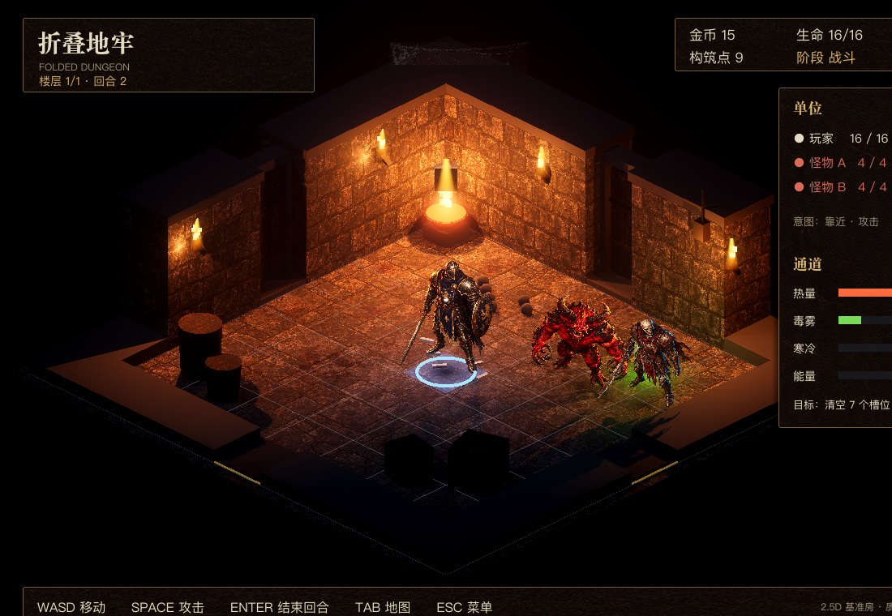

# 09 · 2.5D 暗黑地牢视觉与手感方案（M6）

> 状态：**D11 已定稿（2026-10-31）：B 路线 = 3D 场景 + AI 2D 立绘单位（2.5D 暗黑地牢）**。
> 达标房 v1 已通过方向验收（"差不多，按这个做"）；**M6-1 已落地并由用户验收（2026-10-31：3D 房间 + 立绘单位 + 皮革 HUD 接入真实牌局）**；**M6-2 第一版已落地**（3D 宏观构筑地图 + 16 房间主题 + 通道贴花/粒子）；**M6-3 第一版已落地**（事件驱动战斗 FX）；**M6-4 第一版已落地**（标题界面/皮革主题/字体/结算）；**M6-5 第一版已落地**（程序合成 SFX/环境 loop/音量设置）。本方案替代早期"16×16 像素"方案（像素版只保留在 `docs/art-concepts/` 与 git 历史）。
> 基准图：[`docs/art-concepts/targets/2.5d/bench-room-v1.png`](art-concepts/targets/2.5d/bench-room-v1.png)；可执行任务见 [`.agents/plans/2026-10-31-M6-视觉与手感升级.md`](../.agents/plans/2026-10-31-M6-视觉与手感升级.md)。



### 2.1 M6-1 第一版实施记录（2026-10-31）

- 主场景切换为 `game/presentation/run_mode/run_mode_3d.tscn`（Forward+、3D 正交相机、皮革悬浮 HUD）；
- `Room3D` 由 `RoomLayout` 生成：地面/墙体/四朝向门/道具/光效/通道地表；`Unit3D` 用 AI 立绘 + 地面投影 + 血条；
- 接入真实 `RunController`：构筑（1/2/3 + 鼠标选格 + R + Enter）、探索、战斗（WASD/Space/Enter）、事件/休整/商店、结算、相机跟随；
- 资产入库：`game/assets/art3d/{materials,units,manifests}`；生成/后处理脚本 `game/tools/art/`；
- 测试：**33 cases / 92 tests / 1520 assertions 全绿**；新增资产清单与门位映射测试；
- 截图：`docs/screenshots/m6-1-{build,explore,battle}.png`。

**v2 打磨（2026-10-31，第一轮）：**
- 单位：补齐玩家/炎魔/骷髅的**攻击姿态帧**（AI 出图 + 绿幕抠像），`play_attack()` 自动切换攻击帧并做前冲/缩放；
- 门洞：门框换成受光石材质 + 门内冷雾/冷光，缓解纯黑 void；
- 场景：新增锁链、墙盾、蜡烛、骷髅头、碎石、血迹、小木箱等细节；火盆移到右后角避免与敌人站位重叠；
- HUD：面板金色角饰、标题下金线、通道彩色标签、底栏分隔；相机加入玩家跟随，避免角色被面板长期遮挡；
- 截图：`docs/screenshots/m6-1-{build,explore,battle,attack}.png`。

**剩余差距（v2 继续）：** ①立绘与光照仍可更融合（区域色偏、地面接触阴影更实、受击帧）；②门洞外远景/雾还需更自然；③房间道具仍偏少且缺少按房间主题的变体；④HUD 图标/卡牌视觉未细化；⑤音效未接。

### 2.2 M6-2 第一版实施记录（2026-10-31）

- **3D 宏观构筑地图**：`MacroMap3D` 用 5×5 地牢格展示已建房间（主题色块 + 门位标记 + 当前房间金边）；
- **放置 ghost**：绿色/红色半透明房间块 + 旋转后的门位标记 + 房间名/无效提示；鼠标 3D 拾取、方向键移动、R 旋转（HUD 显示 90° 步进）、Enter 建造；
- **相机模式**：构筑阶段自动切到宏观俯瞰（正交 size 16→10.2 平滑过渡），探索/战斗回到房间视角，房间切换有暖色闪屏；
- **16 房间主题**：`RoomTheme` 为 16 个 RoomDef 配置 tint/accent/decor；`Room3D` 按主题染色地面/墙体，并生成熔炉/冰晶/毒沼/线圈/导管/镜面/回声/重力/折叠/宝库/箭塔/Boss 等程序化装饰；
- **通道表现**：Danger 区域使用 Decal（柔边）替代亮色方块，加 CPUParticles3D 飘浮粒子，按通道值控制强度；
- 截图：`docs/screenshots/m6-2-{build,rotate,build-full,room-0-forge_room,room-1-frost_room,room-2-toxin_room,room-3-vault_room}.png`；
- 测试：**34 cases / 95 tests / 1631 assertions 全绿**（新增宏观格映射/16 房间主题覆盖测试）。

**M6-2 剩余：** 房门/替换交互的 UI 细化、门对门匹配提示、宏观图房间图标与拖拽放置、更多主题道具变体；这些可以放到 M6-3/M6-4 前继续补。

### 2.3 M6-3 第一版实施记录（2026-10-31）

- **事件→FX 映射**：`CombatFx` 纯函数把规则事件（wave_emitted/entered/hit/redirected、reaction_triggered、room_periodic turret/boss）与战斗事件（unit_attacked/died/knockback、turret_hit、hazard_damage、boss_ability、stun）映射为表现描述，可单测；
- **战斗表现**：命中爆点 + 斩击光弧 + 受击闪红 + 伤害数字 + 镜头抖动；死亡淡出/下沉 + 骨尘粒子；击退/碰撞尘土；
- **规则表现**：火焰波/冰霜波等投射物、镜面转向的冷色爆点、反应（爆燃/相消/释放）的彩色爆发+扩散环；箭塔箭矢；Boss 能力红环；
- **Boss/精英**：Boss 立绘放大 + 红色光环/灯光；精英立绘紫色调；
- **测试**：新增 `test_m6_3_fx_map.gd`（35 cases / 99 tests / 1647 assertions 全绿）；
- 截图：`docs/screenshots/m6-3-{battle,hit,fx,boss}.png`。

**剩余（M6-4/M6-6 继续）：** 真正的序列帧攻击/受击动画、投射物按真实规则事件逐帧演示（当前为事件驱动即时 FX）、Boss 专属立绘、音效；UI/标题/结算在 M6-4。

### 2.4 M6-4 第一版实施记录（2026-10-31）

- **主场景改为标题界面** `presentation/ui/title_screen.tscn`：D 主视觉背景 + 暗色遮罩/底部渐变 + 衬线大标题 + 菜单（开始/操作说明/退出）+ 淡入；
- **字体**：Noto Serif SC（OFL）下载后实例化到 wght=500、按 UI 字符集子集化，产物 **205 KB**（`game/assets/art3d/fonts/NotoSerifSC-Subset.ttf` + `OFL.txt`），生成脚本/字符表在 `.tmp`（后续可脚本化）；
- **主题**：`DarkUI` 助手 + 生成 `presentation/ui/dark_theme.tres`（皮革面板/按钮/字体/颜色），HUD 与标题共用；
- **HUD**：蓝图卡加入房间主题色条、事件/商店/休整面板加标题与描述、结算面板加结果文案 + "R 再来一局 / T 返回标题"、F3 调试面板、Esc 返回标题；
- **流程**：标题→单局→结算→重开/标题闭环；`game/tools/godot run` 现在是标题界面；
- 截图：`docs/screenshots/m6-4-{title,build,event,settle}.png`（后台离屏采集）；
- **QA 回修（同日）**：标题主按钮/默认焦点与按钮不透明度、构筑 ghost 半透明+描边与蓝图选中态/左对齐、事件说明字号/间距/底部留白、结算全屏压暗+副标题对比度+底栏 R/T 文案；
- 测试：**36 cases / 103 tests / 1658 assertions 全绿**（新增字体/主题/标题场景测试）。

**剩余：** 标题界面细节（按钮悬停动效/标题字标/继续游戏读档）、HUD 图标套装、商店/事件插画、结算统计细化；音效在 M6-5。

### 2.5 M6-5 第一版实施记录（2026-10-31）

- **程序合成音频**（`game/tools/audio/gen_sfx.py`，numpy，无外部采样）：脚步×3、挥砍、命中、死亡、爆炸、电流、蒸汽、开门、建造、金币、UI 点击/错误、Boss 吼、胜利/失败，共 18 个 WAV + 30s 无缝地牢环境 loop（`game/assets/audio/`，1.6MB）；
- **总线**：`default_bus_layout.tres`：Master / Music / SFX；
- **AudioManager 自动加载**：8 路 SFX 播放池 + 环境 loop（运行时设置 WAV 循环）、音量/静音持久化到 `user://audio_settings.cfg`；
- **接入**：标题 UI 点击/设置面板滑杆；探索脚步/开门；战斗挥砍/命中/死亡/反应（燃烧/相消/放电）/箭塔/Boss 吼/眩晕；建造/旋转/错误；结算胜利/失败；
- 测试：**37 cases / 107 tests**（新增音频文件/环境流/总线/自动加载测试）。

**剩余：** 更细的脚步随机化、音量设置从标题同步到暂停菜单、音乐层（当前为环境 loop）；M6-6 做验收/GIF/README/导出准备。

---

## 1. 为什么是 2.5D（B 路线）

| 方案 | 问题 |
|---|---|
| 纯像素（已废弃） | 做到最后仍是"精致方块"，达不到参考图的材质/光照/暗黑氛围 |
| 全写实 3D | CC0 没有足够好的写实暗黑套件，需要付费资产/大量建模，周期不可控 |
| **3D 场景 + AI 立绘（选定）** | 3D 提供真实光照/阴影/材质/景深质感；AI 立绘提供暗黑风角色/怪物；两者组合最接近参考图且可批量生产 |

核心思路：**房间是 3D 的，单位是"立绘"的**（Diablo 1/2 的精灵思路 + 现代 3D 灯光）。模拟层（`game/core/`）一行不改。

---

## 2. 基准房 v1 已确认的内容

| 层 | 实现 |
|---|---|
| 房间 | AI 生成石墙/地砖/木门材质（1024 + 程序生成法线），3D 盒体墙/地面，相机正交斜俯视（约 45° yaw / 32° pitch） |
| 光照 | Forward+：低频冷环境光 + 火盆/火把暖点光带阴影 + 毒雾绿光 + SSAO + Glow + 深度雾/体积雾 + ACES 色调映射 + 暗角 |
| 单位 | 你配的 `gpt-image-2.5-sunburst` 生成暗黑立绘（重甲骑士 / 炎魔 / 骷髅战士），绿幕抠像 → Sprite3D 固定 Y 轴朝向 + 地面投影 + 脚下符文环 |
| 氛围 | 火盆火焰粒子、墙上火把、毒雾区、血迹/蛛丝/碎石/木箱木桶、低频尘埃 |
| HUD | 皮革面板 + 宋体/暗金描边，全屏房间 + 悬浮 HUD |
| 参考素材 | `targets/2.5d/`：基准图、3 个单位立绘、4 张材质参考 |

---

## 3. 视觉规范

### 3.1 相机与画布

| 项 | 取值 |
|---|---|
| 画面 | **全屏房间 + 悬浮 HUD**（设计目标 1280×800；亦支持窗口 1100×760） |
| 相机 | `Camera3D` 正交投影；位置 `center + (9.8, 8.8, 9.8)`，look_at 房间中心 `y≈1.0`；`size≈9.4`（1100×760 下） |
| 世界单位 | 1 tile = 1 unit；房间 9×9 = 9×9 units；墙高 2.2；门在墙中点 |
| 单位高度 | 玩家 ≈1.8–2.0 units；普通怪 ≈1.4–1.7；Boss ≈2.5+ |
| 后期 | Forward+：SSAO、Glow、Volumetric Fog、ACES、Adjustments（contrast 1.06 / saturation 1.05） |

### 3.2 光照与调色

- 环境：低能量冷色环境光（`#22252f` 方向），保留大块阴影；
- 暖光：火盆 5–6 能量、火把 3–3.5 能量，均有阴影；火焰带闪烁（噪声驱动）；
- 冷光：玩家脚下/毒雾区冷色补光，避免全画面橙黄；
- 通道色：热量橙红、毒雾绿、寒冷青蓝、能量金黄、气流冷白；**每种通道另有图案/图标（色盲安全）**；
- 背景保持近黑（`#07070a`），用暗角/雾把房间"包"起来。

### 3.3 材质

| 材质 | 规格 |
|---|---|
| 石砖地面/墙面 | 1024×1024 无缝 AI 纹理 + 程序生成法线（Sobel），roughness 0.88–0.92 |
| 木门/木箱 | 1024 无缝木纹 + 法线；金属件用 metallic 材质 |
| 皮革 HUD | 1024 皮革纹理，9-slice/拉伸铺底 + 金色描边 |
| 火焰/雾 | 程序生成贴图（flame / fog-noise / shadow-blob / blood） |

> 规则：所有材质只从"AI 生成 + 程序化后处理"产出，保留 prompt 与生成参数；不混入风格不一致的外部包（KayKit 仅作对比验证，不作为本项目资产）。

### 3.4 单位立绘（核心）

- 来源：AI 生成（暗黑风、斜俯视全身、纯绿幕背景）→ 抠像/边缘去溢色 → 裁切；
- 渲染：`Sprite3D`，`BILLBOARD_FIXED_Y`，`ALPHA_CUT_DISCARD`，按目标高度设置 `pixel_size`；
- 融合：地面椭圆投影、按区域暖/冷 `modulate`、受击闪白/闪红、脚下符文环；
- 动画（低成本方案）：
  - 每个单位生成 **3 个姿态**（idle / attack / hurt）作为帧；
  - 移动用程序化 bob + 朝向翻转 + 残影；攻击用前冲/缩放 + 攻击帧 + FX；死亡用淡出/下沉；
  - 后续可扩展为 4–6 帧或序列帧，接口不变。
- 血条：单位头顶/右侧 2D 血条（CanvasLayer 投影屏幕坐标）或 `Label3D`，随 `Unit` 数据刷新。

### 3.5 UI

- 风格：深色皮革 + 暗金描边 + 宋体（Noto Serif SC，OFL），标题可用衬线大字；
- 布局（全屏 + 悬浮）：
  - 左上：标题/楼层/回合；
  - 右上：金币/构筑点/生命；
  - 右侧：单位列表 / 意图 / 通道条；
  - 底部：按键提示；
  - 5×5 地图：可折叠浮层（Tab），或左上小地图；
  - 主视觉 D 用于标题界面背景。
- 组件：面板/按钮/标签页/蓝图卡/图标（金币/BP/HP/五通道/12 房间）；F3 调试面板。

---

## 4. 资产方案与生产管线

### 4.1 来源与许可

| 资产 | 来源 | 说明 |
|---|---|---|
| 房间材质、单位立绘、UI 皮革、图标 | 用户本机 Azure `gpt-image-2.5-sunburst`（`quality=max`） | 生成后处理入仓；发行前复核模型服务条款 |
| 程序化贴图 | 自研脚本（Python/Pillow）：法线、火焰、雾、阴影、血迹、符文 | Apache-2.0 |
| 中文衬线字体 | Noto Serif SC（OFL）子集 | 附 OFL 许可 |
| 参考/可选对比 | KayKit Dungeon/Adventurers/Skeletons（CC0） | **不进入最终资产**，仅作 3D 路线对照 |

### 4.2 仓库结构

```text
game/assets/art3d/
├── materials/        # 石墙/地砖/木门/皮革等 albedo + normal（PNG）
├── units/            # 玩家/怪物/Boss 立绘帧（PNG，透明）
├── props/            # 火盆/木箱/骸骨/蛛网等公告板或 3D 模型贴图
├── ui/               # 面板 9-slice、图标、符文
└── fonts/            # Noto Serif SC 子集 + LICENSE
game/tools/art/
├── gen_textures.py   # 纹理生成/裁切/法线（调用 Sunburst 或读取已生成图）
├── gen_units.py      # 立绘绿幕抠像/裁边/尺寸统一
├── gen_ui.py         # 皮革面板/图标后处理
├── normal_from_albedo.py
└── verify_assets.gd  # 资产清单/引用校验（CI）
```

- 生成脚本**不含密钥**，从环境变量读取；生成结果提交仓库（PNG），保证离线可复现。
- 每类资产附 `manifest.json`（文件名 → 用途 → 尺寸），Godot 端按名字引用。

### 4.3 资产清单（生产目标）

| 类别 | 数量 | 说明 |
|---|---|---|
| 房间材质 | 6–8 套 | 石墙/地砖 ×2、木门、金属、皮革、毒/冰/火变体 |
| 单位立绘 | 玩家 1 + 普通怪 3 + 精英 2 + Boss 1 | 每个单位 3 姿态（idle/attack/hurt）+ 死亡特效 |
| 道具立绘/3D | 10–14 | 火盆、火把、木箱、木桶、骸骨、蛛网、旗帜、宝箱、刑具 |
| UI | 面板/按钮/卡片/图标 ~40 | 皮革 + 金边，统一 9-slice |
| 特效贴图 | 火/雾/尘/血/电弧/治疗 ~12 | 程序生成或 AI 生成 |

---

## 5. 表现层架构

### 5.1 渲染与场景

- `project.godot`：`renderer/rendering_method="forward_plus"`（保留 `gl_compatibility` 作为 fallback 记录）；Window 尺寸按 §3.1。
- 新场景结构（替换 2D `RoomView`）：

```text
RunMode3D (Node3D)
├── WorldEnvironment        # 环境/雾/Glow/SSAO/调色
├── Room3D (Node3D)         # 由 RoomLayout 生成
│   ├── Floor (MeshInstance3D, 材质平铺)
│   ├── Walls (Node3D, 缺省前墙 cutaway，低矮护栏)
│   ├── Doors (Node3D, 4 朝向)
│   ├── Hazard (Node3D, 通道贴花/灯/粒子)
│   ├── Props (Node3D)
│   └── GridOverlay (薄线/选中格)
├── Units (Node3D)          # Sprite3D 立绘 + 阴影 + 法阵
├── Fx (Node3D)             # GPUParticles3D / Label3D 伤害数字
├── Camera3D (正交斜俯视)
└── HUD (CanvasLayer)       # 全屏悬浮 UI
```

### 5.2 运行时映射

| 数据 | 表现 |
|---|---|
| `RoomLayout.terrain[9×9]` | 地面材质 + 墙体；边界按朝向生成墙/门 |
| `RoomDef.door_mask` + `RoomInstance.orientation` | 4 朝向门（当前关卡只放对应门，其余为墙） |
| `RoomLayout.hazard_cells` | 通道地表贴花（平面/粒子）+ 局部灯光 |
| `RoomInstance` 通道值（0–1000） | 贴花透明度/粒子密度/灯光能量/飘字 |
| `Unit`（id/cell/hp/status/team） | 立绘实例：移动 tween、姿态、血条、状态图标、死亡 |
| 事件日志（`unit_attacked` / `unit_died` / `channel_changed` / `room_periodic` / `wave_*` / `turret_*` / `boss_heat` / `combat_won` …） | FXDirector：粒子/伤害数字/闪白/镜头抖动/音效 |

### 5.3 输入与相机

- 键盘：WASD/方向键移动、Space 攻击、Enter 结束回合、1/2/3 选项、R 旋转、Esc 菜单（沿用现有语义）。
- 鼠标：屏幕坐标 → `Camera3D.project_ray_origin/normal` → 与 y=0 平面求交 → `floor()` 得格；建造 ghost 用 3D 半透明盒/贴花。
- 相机：固定正交斜俯视；受击/爆炸做小幅 offset 抖动 + zoom 冲击；不做自由旋转（保持战术可读性）。

### 5.4 确定性与测试

- `game/core/` 不改；动画只读状态/事件，禁止回写。
- 输入缓冲 1 格；动画不阻塞回合推进。
- headless 测试不实例化 3D 视图；新增资产/映射纯函数测试。
- 截屏/GIF 用现有 capture 工具扩展。

---

## 6. 手感设计

| 动作 | 视觉 | 镜头 | 音效 |
|---|---|---|---|
| 移动一格 | 立绘 bob + 尘土 + 朝向翻转 | 无 | 脚步 ×3 |
| 攻击 | 前冲 0.08s + 攻击帧 + 受击闪白 + 伤害数字 | 2px 抖动 | 挥砍/命中 |
| 击退 | 滑步/抛物线 + 撞墙火星 | 3px | 撞击 |
| 死亡 | 立绘下沉/淡出 + 碎骨/血雾 | 1px | 碎裂 |
| 建造 | 半透明 ghost → 落地扬尘 + 门缝金光 | 轻 zoom | 落地 |
| 旋转 | 门位高亮 + 咔哒 | 无 | 咔哒 |
| 穿门 | 0.15s 白闪/滑动 | 无 | 开门 |
| 通道 tick | 地表贴花脉动 + 粒子 + 飘字 | 无 | 低频 |
| 爆燃 | 火焰粒子爆发 + 橙闪 + 燃烧图标 | 5px + 45ms 顿帧 | 爆炸 |
| 冷热相消 | 蒸汽白雾 + 冰/火图标 | 2px | 嘶嘶 |
| 充能释放 | 电弧链 + 黄闪 | 4px | 电流 |
| 火焰波/镜面 | 投射物拖尾 + 镜面火花 + 折线偏转 | 2px | 呼啸 |
| 箭塔 | 预警线 → 箭矢 → 命中 | 2px | 弓弦 |
| Boss 能力 | 红预警圈 + 地面裂纹 | 6px | 低吼 |
| 胜/负 | 慢动作 + 横幅 + 结算 | 无 | 胜负音 |

可访问性：抖动/闪光/伤害数字开关；通道图标+颜色双编码。

---

## 7. 音频

- 程序合成（Python + numpy/wave）生成 WAV：脚步×3、挥砍、命中、爆炸、电流、开门、建造、金币、UI、Boss 吼、胜负；
- 环境 loop：地牢低频风声/滴水/火焰噼啪（30–60s，可循环）；
- 总线 Master/Music/SFX，设置界面可调；全部自有，无外部采样。

---

## 8. 里程碑（M6，6 步）

| 步 | 目标 | 验收 |
|---|---|---|
| **M6-1 基准房 v2（质量门）** | 在已验收 v1 上完成：单位融合（阴影/受击/攻击帧/血条/伤害数字）、光影调色、道具与地面细节、UI 样张 | 新基准图与 v1/参考图并排：不出现"贴上去"的立绘感，氛围达标；测试全绿 |
| **M6-2 房间与构筑系统** | 全部 16 房间主题、门/旋转/替换、3D ghost、五通道表现、地图浮层 | 构筑/探索一局可玩；12×12 组合视觉无破绽；截图达标 |
| **M6-3 单位与战斗表现** | 玩家/3 怪物/精英/Boss 立绘与姿态、血条、伤害数字、投射物/火焰波/镜面/箭塔/Boss 能力 | 战斗全流程有反馈；事件→FX 映射测试 |
| **M6-4 UI/HUD/标题/结算** | 皮革 UI 全套、蓝图卡/事件/商店/休整、主视觉 D 标题界面、结算 | 一局全界面可读；中文无豆腐块；README 首图可用 D |
| **M6-5 音频与氛围** | 12+ SFX、环境 loop、音量/静音设置 | 关键动作有声；资源加载测试 |
| **M6-6 验收与发布素材** | 截图/GIF、README/docs、导出准备、性能与手工验收 | README D 首图+实机 GIF；测试全绿；60fps |

> 顺序：M6-1 → M6-2 → M6-3 →（M6-4、M6-5 可并行）→ M6-6。

---

## 9. 验收标准

| # | 标准 | 检查 |
|---|---|---|
| V1 | 任意截图能看出：3D 地牢房间、火把/阴影、玩家/怪物、至少一种通道 | 目标图并排 |
| V2 | 单位、血量、状态、危险格 1 秒可读 | 手工清单 |
| V3 | 移动/攻击/击退/建造/反应 ≤150ms 有反馈 | 录屏 |
| V4 | 通道颜色 + 图标/图案双编码 | 色盲模拟 |
| V5 | `game/tools/godot test` 全绿（86+ 断言数只增不减） | CI + 本地 |
| V6 | 1280×800、Forward+、M 系列 Mac 稳定 60fps | 运行时 FPS |
| V7 | 资产可复现：脚本 + prompt + manifest；无密钥入仓 | 资产校验测试 |
| V8 | README：D 首图 + 3 张实机截图 + GIF | 人工 |

---

## 10. 测试与验证

- `game/tools/godot test` 保持全绿；新增：
  - `test_asset_manifest.gd`：清单/文件/字体/许可存在，3D 资源可加载；
  - `test_room3d_mapping.gd`：`terrain→墙/地`、`door_mask+orientation→门`、`channel→decal id`、`event→fx id` 纯函数；
  - `test_ui_theme.gd`：UI 场景实例化 + 中文字体覆盖。
- 快照不变性：视图动画跑一段战斗后 `RunController.snapshot()` 与无视图一致。
- 截图/GIF：扩展 `capture_readme_shots`；Godot Movie Maker PNG 序列 + Pillow 合成 GIF（无 ffmpeg）。
- 手工：§6 手感表 + docs/07 §4 可读性清单。

---

## 11. 风险与回退

| 风险 | 缓解 |
|---|---|
| AI 立绘一致性/动画帧不足 | 每单位 3 姿态 + 程序化运动；接口按帧序列设计，后续可替换为 6–8 帧 |
| 立绘"贴上去"的平面感 | 接触阴影、区域调色、边缘光贴图、受击闪白/粒子；必要时加轻微 billboard 倾斜 |
| Forward+ 在目标机/Windows 的性能与兼容 | 目标 PC 桌面；保留 GL Compatibility fallback 记录；粒子/阴影预算；M4 实测 60fps |
| AI 生成成本/等待 | 草稿低 quality → 终稿 max；prompt 缓存与生成脚本 |
| AI 内容条款 | 发行前复核模型服务条款；保留生成记录 |
| 3D 鼠标拾取/建造手感 | 固定正交相机 + 平面求交；先做格子高亮 ghost 再验证 |
| 范围蔓延 | 6 步计划；音频/标题可裁剪；未完成功能回退到 M6-1 基准 |

---

## 12. 假设（不阻塞）

- 画面 1280×800 全屏房间 + 悬浮 HUD；本机截图用 1100×760。
- 单位以 AI 立绘为主；后续若需要真正 3D 角色再评估（不在 M6）。
- 中文用 Noto Serif SC（OFL）子集。
- 外部 CC0 套件不进入最终资产，仅作对照；主视觉 D 用于标题/README。
