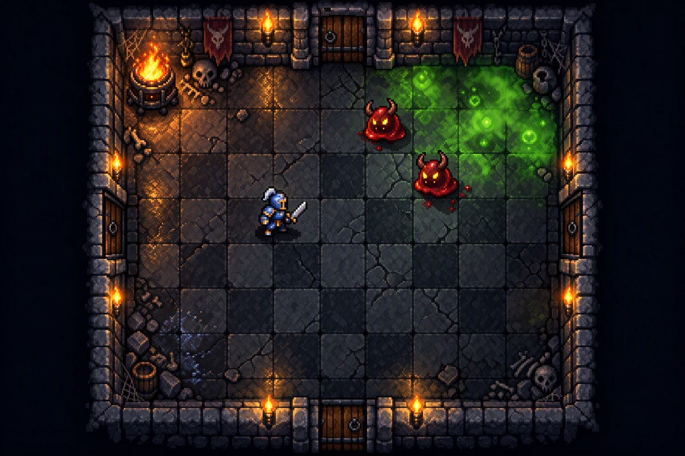
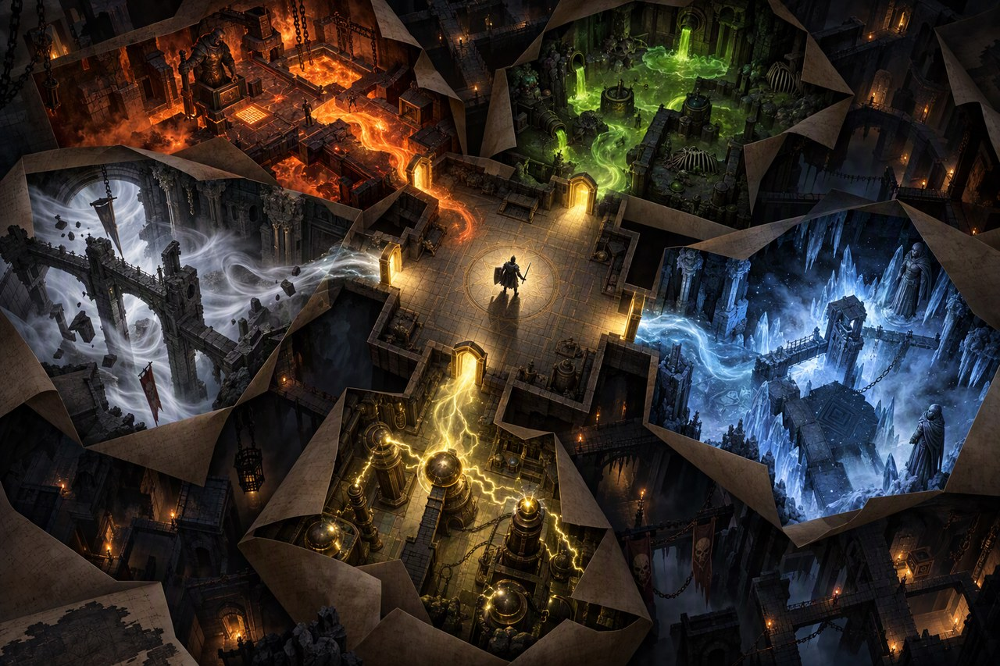
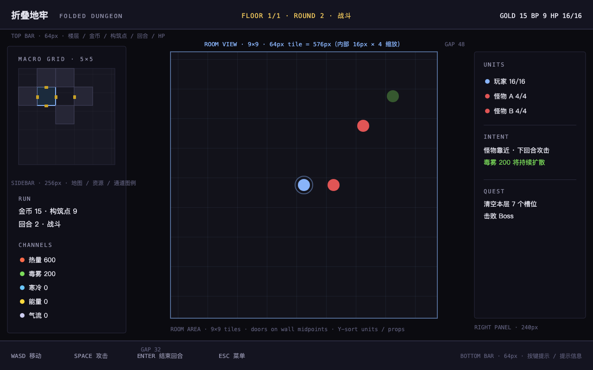

# 09 · 视觉与手感升级方案（M6：像素地牢 + 折叠主视觉）

> 状态：**D11 已定稿（2026-10-31）：游戏内 = A 像素地牢；主视觉/封面 = D 折叠地牢**。本文是设计规范与实施方案，**尚未开始改造代码**；可执行任务拆解见 [`.agents/plans/2026-10-31-M6-视觉与手感升级.md`](../.agents/plans/2026-10-31-M6-视觉与手感升级.md)。
>
> 目标画面：`docs/art-concepts/targets/`（AI 概念稿，用于定调与验收对照；不是游戏实机）。





---

## 1. 为什么是这套组合

| 选择 | 理由 | 代价 |
|---|---|---|
| 游戏内 **A · 像素地牢** | 最直接解决"没有游戏感"；像素资产可程序化生成、可迭代、许可干净；16×16 网格与现有 9×9 逻辑天然对齐 | 需要自建一套像素资产与动画（工作量最大头） |
| 主视觉 **D · 折叠地牢** | 一眼讲清"房间折叠 + 五通道"的核心概念；适合 README 首图、标题界面、商店胶囊图 | 与游戏内像素风不同调，需要明确"封面 ≠ 实机"的边界 |
| 不做 | 3D 重写、真人/写实美术、完整商用密码级美术 | — |

**核心原则不变**：模拟层（`game/core/`）不动、86 个测试不动；视觉与动画全部在 `presentation/` 层，由状态与事件日志驱动。

---

## 2. 验收标准（"像游戏"的可检验定义）

| # | 标准 | 检查方式 |
|---|---|---|
| V1 | 任意一张截图能认出：9×9 房间、墙/门、玩家、怪物、至少一种环境通道 | 把截图给没看过本项目的人问"这是什么游戏画面" |
| V2 | 玩家/怪物/血量/状态/危险格在 1 秒内可读 | 手工验收清单（见 §8） |
| V3 | 移动、攻击、击退、建造、反应触发都在 ≤150ms 内给出视觉反馈 | 逐项录屏核对 |
| V4 | 通道状态有"颜色 + 图标/图案"双编码（色盲安全） | 通道图例与色盲模拟检查 |
| V5 | `game/tools/godot test` 保持全绿且断言数只增不减 | CI 与本地命令 |
| V6 | 1280×800、GL Compatibility、M 系列 Mac 上稳定 60fps | 运行时 FPS 监控 + 压力场景 |
| V7 | 所有资产可复现：脚本生成或 CC0 来源 + 映射表，仓库内附许可 | 资源加载测试 + `game/assets/LICENSES/` |
| V8 | README 更新为 D 首图 + 至少 3 张像素实机截图 + 1 个 8–12 秒 GIF | 人工核对 README |

---

## 3. 视觉规范（Art Bible）

### 3.1 渲染参数

| 项 | 取值 |
|---|---|
| 窗口 / 视口 | **1280×800**，`canvas_items` 拉伸，整数倍缩放 |
| 像素源尺寸 | tile / 角色 / 道具统一 **16×16 源像素** |
| 显示缩放 | **×4**（房间 9×9 → 576×576）；UI 图标按 ×2/×3 |
| 纹理过滤 | Nearest，关闭 mipmap；2D transform 像素对齐 |
| 灯光 | 火把暖光 + 环境冷色；GL Compatibility 下优先"假光"（发光贴图/叠加精灵），必要时再上 `PointLight2D` |
| 后期 | 低强度 vignette、受击闪白、屏幕抖动（均可在设置关闭） |

### 3.2 调色板（锁定 24 色，全部资产共用）

| 角色 | 颜色 | 用途 |
|---|---|---|
| 背景/地牢 | `#0b0b10` `#141420` `#1d1d2a` | 场景底色、面板、阴影 |
| 石砖 | `#24242f` `#2b2b38` `#3c3c52` `#4e4e68` `#16161e` | 地板/墙/勾缝 |
| 火光 | `#ff8a3d` `#ffb347` `#ffe08a` | 火盆、火把、爆燃 |
| 毒 | `#3f7c33` `#7bdc5a` `#b6f09a` | 毒雾、中毒 |
| 冷 | `#2e5f8f` `#6cc7ff` `#c8ecff` | 冰霜、寒冷 |
| 能量 | `#8a6a12` `#ffd93d` | 蓄能、充能爆发 |
| 气流 | `#8f8fa8` `#cdcdf0` | 风暴、气流 |
| 单位 | `#89b4fa` `#4a7dc4`（玩家）/ `#e05555` `#a83a3a`（怪物）/ `#b48cff`（Boss） | 阵营辨识 |
| 文字 | `#e6e6f0` `#8f8fa8` `#5c5c78` | 主/次/说明 |
| 门/金 | `#8a5a2b` `#e8c15a` | 木门、门缝、金币 |

> 规则：**通道只允许用上表对应色**；自定义补件不得引入新色相，最多调整明度。

### 3.3 字号与字体

| 层级 | 字体 | 大小（源） | 信息 |
|---|---|---|---|
| 标题 | Fusion Pixel 12px（OFL） | ×3 = 36px | 标题界面、结算 |
| 界面正文 | Fusion Pixel 12px | ×2 = 24px | HUD、按钮、提示 |
| 小字/数字 | Fusion Pixel 12px | ×1.5 = 18px | 伤害数字、状态、坐标 |

中文全部走 Fusion Pixel；英文/数字可混用同一字体（含 monospace 变体）。字体文件随包附 OFL 许可，构建时按"游戏内实际用字"子集化。

### 3.4 屏幕布局（1280×800）



| 区域 | 坐标 / 尺寸 | 内容 |
|---|---|---|
| 顶部状态条 | `(0,0) 1280×64` | 标题、楼层/回合、金币/构筑点/HP |
| 左侧栏 | `(16,100) 256×620` | 5×5 宏观地图（`)40px` 格）、资源、通道图例 |
| 房间视图 | `(368,112) 576×576` | 9×9 tile，门在中点、单位 Y-sort、通道地表特效 |
| 右侧面板 | `(1024,112) 240×576` | 单位列表、意图预告、当前目标 |
| 底部提示 | `(0,736) 1280×64` | 按键提示 / 上下文提示 |

### 3.5 视觉资产清单（源像素）

| 类别 | 内容 | 数量（帧） |
|---|---|---|
| 地形 | 地板 4 变体、墙 8 变体（含墙角）、门 4 朝向 × 2 状态、出生点标记 | ~40 |
| 场景道具 | 火盆 2 帧、火把 2 帧、木箱/木桶/碎石/骸骨/旗帜/蛛网 | ~20 |
| 玩家 | 16×24：待机 2、行走 4×4 向、攻击 3×4 向、受击 1、死亡 4 | ~40 |
| 怪物 | 16×16：史莱姆/小恶魔各 待机 2、移动 4、攻击 2、死亡 3 | ~22 |
| Boss | 32×32：待机 2、施法 4、受击 2、死亡 4 | ~12 |
| 通道地表 | 热/毒/冷/电/气流 各 2 帧 + 危险预警 | ~12 |
| 反应特效 | 爆燃、蒸汽、电弧、镜面火花、投射物、火焰波、治疗/胜利 | ~25 |
| UI | 面板 9-slice、按钮 3 态、卡片、标签页、图标（金币/BP/HP/5 通道/12 房间）、光标 | ~45 |
| 主视觉 | D（AI 概念稿）+ 标题界面排版 | 1 |

---

## 4. 资产方案（来源与管线）

### 4.1 决策

**主方案：自研像素资产（脚本生成，调色板锁定）。** 理由：

1. 目标画面 A 是 16-bit 细节风，免费 CC0 包（Kenney 偏"可爱扁平"、0x72 偏"粗描边"）与目标气质有差距；
2. 我们的 9×9 房间、门在墙中点、五通道地表、蓝图卡等是**定制几何**，外部包需要大量补件，混用风格风险高；
3. 自研可做到**离线、确定性、许可零依赖**（Apache-2.0 自有），且能随设计迭代；
4. 生成脚本可复用 README 概念图的思路（SVG/Python 像素绘制），产出可 diff、可复现。

**外部 CC0 仅作可选补充**（M6-1 若下载可行）：Kenney Tiny Dungeon（CC0，130 个 16×16 文件）用于怪物/角色备选；Dawnlike（CC-BY 4.0，需署名）不进入首发。

### 4.2 外部素材（已核实，按需使用）

| 素材 | 许可 | 用途 |
|---|---|---|
| [Kenney Tiny Dungeon](https://kenney.nl/assets/tiny-dungeon) | CC0 | 可选：怪物/道具备选（若 M6-1 下载成功） |
| [0x72 DungeonTileset II](https://0x72.itch.io/dungeontileset-ii) | 素材 CC0 | 可选：地砖备选 |
| [OpenGameArt Puny Dungeon](https://opengameart.org/content/16x16-puny-dungeon-tileset) | CC0 | 可选：补件 |
| [DCSS tiles](https://github.com/crawl/tiles) | CC0 | 可选：大量怪物/物品参考或补件（32×32，需重采样） |
| [Fusion Pixel Font 12px](https://github.com/TakWolf/fusion-pixel-font) | OFL-1.1 | **必需**：中文像素 UI 字体 |
| 主视觉 D | 本机 AI 生成 | README/标题/商店图；发行前复核模型服务条款 |

> 若使用任何外部素材，必须更新 `THIRD_PARTY_NOTICES.md` 与 `game/assets/LICENSES/`；CC0 也记录来源与版本。

### 4.3 仓库结构

```text
game/assets/
├── art/
│   ├── tiles/        # 地形 atlas（PNG + JSON 映射）
│   ├── sprites/      # 玩家/怪物/Boss/道具（PNG atlas）
│   ├── fx/           # 粒子贴图、投射物、闪光
│   └── ui/           # 9-slice 面板、按钮、图标
├── fonts/            # Fusion Pixel 子集 + LICENSE-OFL
├── audio/            # 生成的 SFX/环境音（M6-6）
└── LICENSES/         # 外部素材许可副本
game/tools/art/
├── gen_tiles.py      # 16×16 地形/道具生成（调色板锁定）
├── gen_sprites.py    # 角色/怪物帧生成 + atlas
├── gen_ui.py         # 面板/图标/光标生成
├── build_tileset.gd  # 生成 TileSet .tres（含 autotile 邻接）
└── build_theme.gd    # 生成 Theme .tres（字体/9-slice/颜色）
```

规则：
- 生成脚本提交、产物提交（PNG/Tres 小文件），**不依赖运行时外部下载**；
- 每个 atlas 附 JSON 映射（名字 → 坐标），Godot 端只按名字引用；
- 调色板/尺寸/命名在脚本里集中定义，改一次全量重生成。

---

## 5. 表现层架构

### 5.1 当前与目标

当前 `RoomView` 是单节点 `_draw()` 色块渲染（TILE_SIZE=16 内部坐标），`GridMapView` 是色块 5×5。改造为**场景化视图**，但**保留现有公开 API**（`setup / set_player_cell / set_rule_engine / set_combat_units / tile_rect / tile_center / local_door_cells`），`run_mode` 与 `main` 无需大改。

```text
RoomView (Node2D, scale = 4, 内部 16px 坐标)
├── FloorLayer    TileMapLayer   # 地板
├── WallLayer     TileMapLayer   # 墙体/墙角
├── DoorLayer     TileMapLayer   # 门（4 朝向 × 开关状态）
├── HazardLayer   Node2D         # 通道地表贴花 / 预警
├── PropsLayer    Node2D (YSort) # 火盆/箱子/骸骨
├── UnitLayer     Node2D (YSort) # 玩家/怪物/Boss 精灵 + 血条 + 状态图标
├── FxLayer       Node2D         # 粒子/伤害数字/投射物/闪光
├── OverlayLayer  CanvasLayer    # 受击闪白、暗角、屏幕震动由 Camera2D 承担
└── Camera2D                      # 只在房间内做轻微震动/缩放冲击
```

### 5.2 数据映射

| 数据源 | 映射 |
|---|---|
| `RoomLayout.terrain[9×9]` | `0 = 地板`、`1 = 墙`；边界墙按邻接规则选 8 变体 |
| `RoomDef.door_mask` + `RoomInstance.orientation` | 旋转后 4 朝向门 → DoorLayer 对应图块 |
| `RoomLayout.spawn_cells` | 起始房出生点标记（仅装饰） |
| `RoomLayout.hazard_cells[channel]` | HazardLayer 对应通道贴花（毒雾/热浪/霜/电弧/气流） |
| `RoomInstance.channels`（RuleEngine state） | 通道强度 0–1000 → 贴花透明度/粒子密度/颜色脉动 |
| `Unit`（id/cell/hp/status/team） | UnitView：移动 tween、血条、状态图标、死亡淡出 |
| 事件日志（`unit_attacked` / `channel_changed` / `room_periodic` / `wave_*` / `turret_*` / `combat_won` …） | FXDirector：粒子、数字、抖动、音效 |

### 5.3 确定性与动画

- 模拟层**零改动**；视图只读状态/事件。
- 战斗输入不被动画阻塞：移动 tween 0.12s，期间输入进入 1 格缓冲队列；超过则丢弃。
- 所有动画由表现层本地计时；headless 测试不实例化视图（现有 `test_m5_ui` 只验证场景加载，保持）。
- 事件日志用于"一次性"特效（爆燃、充能释放、镜面折转），保证同一局重放时特效一致。

### 5.4 屏幕与 HUD

- `RunMode` 按 §3.4 重排：`GridMapView` 像素化（房间图标 + 门缝 + 当前房高亮），`BuildPanel` 改成 3 张蓝图卡（图标 + 名称 + 费用），右侧合并单位/意图/目标面板，`DebugPanel` 改为 F3 开关。
- 统一 `pixel_theme.tres`：Fusion Pixel、9-slice 面板、按钮三态、图标；所有 UI 颜色只取调色板。
- 主视觉 D 用于标题界面背景（压暗 + 标题/按钮排版），以及 README 首图。

---

## 6. 手感设计（动作 → 反馈）

| 动作 | 视觉 | 相机 | 音效 |
|---|---|---|---|
| 移动一格 | 角色行走动画 + 落脚尘土 | 无 | 脚步（3 变体） |
| 攻击 | 前冲 0.08s + 受击闪白 + 伤害数字 | 2px 抖动 | 挥砍/命中 |
| 击退 | 抛物线/滑步 + 撞墙爆点 | 3px 抖动 | 撞击 |
| 怪物死亡 | 碎裂/消散 0.25s + 阴影消失 | 1px | 嘶吼/碎裂 |
| 建造房间 | ghost 半透明 → 落地扬尘 + 门缝金光 | 轻微 zoom 1.02 | 落地/金币 |
| 旋转房间 | 门位高亮旋转动画 | 无 | 咔哒 |
| 穿门 | 0.15s 白闪/滑动转场 | 无 | 开门/脚步 |
| 通道 tick | 对应地表贴花脉动 + 飘字（+200 热量） | 无 | 低频嗡鸣 |
| 爆燃 | 火焰粒子爆发 + 橙色全屏闪 + 燃烧图标 | 5px 抖动 + 0.05s 顿帧 | 爆炸 |
| 冷热相消 | 蒸汽白雾 + 霜/火图标抵消 | 2px | 嘶嘶 |
| 充能释放 | 电弧链 + 黄色闪光 | 4px | 电流 |
| 火焰波/镜面折转 | 投射物拖尾 + 镜面火花 + 折线偏转 | 2px | 呼啸/清脆 |
| 箭塔开火 | 预警线 → 箭矢飞行 → 命中 | 2px | 弓弦/命中 |
| Boss 能力 | 红色预警圈 + 地面裂纹 | 6px | 低吼 |
| 胜/负 | 0.2s 慢动作 + 横幅 + 结算面板 | 无 | 胜利/失败 |

可访问性：设置中提供"屏幕抖动 / 闪光强度 / 伤害数字"开关；通道色盲安全：每种通道额外用图案/图标区分。

---

## 7. 音频方案

- **程序合成**（Python + numpy/wave），提交 WAV 源与生成脚本：脚步 ×3、挥砍、命中、爆炸、电流、开门、建造、金币、UI 点击、Boss 低吼、失败/胜利 stinger；环境循环 30–60s（低频地牢氛围）。
- 总线：Master / Music / SFX，设置界面可调；所有音效许可为本项目自有。
- 音频是 M6-6 可裁剪项：若手感阶段未完成，可先静音上线，不阻塞视觉验收。

---

## 8. 测试与验证

| 层 | 手段 |
|---|---|
| 模拟层 | `game/tools/godot test` 保持 **86 tests / 1472 assertions** 全绿（核心不改） |
| 资产层 | 新增 `test_art_pipeline.gd`：所有 atlas/tres/theme/font 可加载；tile 映射覆盖所有 layout 组合；外部许可文件存在 |
| 视图层 | 新增 `test_view_mapping.gd`：9×9 地形 → tile 坐标、门旋转、通道 → 贴花 id、事件 → FX id（纯函数，无渲染） |
| 截图 | 扩展 `game/tools/capture_readme_shots.gd`：构筑/战斗/Boss 三态截图；GIF = Godot `--write-movie` PNG 序列 + Pillow 合成（本机无 ffmpeg） |
| 性能 | 1280×800 下用运行时 FPS 打印；粒子/投射物上限 200；不达 60fps 则先降粒子 |
| 手工 | `docs/07 §4` 可读性清单 + §6 手感表逐项打勾；色盲模拟检查 |

---

## 9. 风险与回退

| 风险 | 影响 | 缓解 |
|---|---|---|
| 自研像素资产达不到目标画面 | 观感仍"廉价" | M6-1 先做**最小房间切片**并对照 target A 迭代；角色/怪物可先用简化 2 帧，后续再加帧 |
| 资产量大、管线复杂 | 拖慢里程碑 | 先交付 MVP 资产（§3.5 中标记的基础集），扩展项放 M6-4/M6-6；生成脚本保证批量修改 |
| Kenney 下载不可用 | 少一个可选来源 | 主方案自研，不依赖下载；CC0 仅加分项 |
| 中文字体文件过大 | 仓库膨胀 | 子集化（fonttools）或 woff2；附 OFL 许可 |
| GL Compatibility 灯光效果差 | 画面不达预期 | 以假光/叠加贴图为主，PointLight2D 为辅；不引入 Forward+ 依赖 |
| 动画影响输入/测试 | 手感或回归风险 | 动画纯表现层、输入缓冲；核心测试不实例化视图 |
| 主视觉 D 与实机风格不一致 | 宣传误导 | README 同时放 D 首图 + 像素实机截图，明确"概念主视觉 / 实机画面" |
| AI 主视觉的商用条款 | 发行风险 | 仅用于 README/原型宣传；发行前复核模型服务条款，必要时重绘 |
| 范围蔓延（音频/标题/商店） | 视觉核心延期 | M6-6 可裁剪；M6-7 之前不做商店页/Steam 素材 |

**回退**：M6 开始前打 tag `m6-pre`；旧 `_draw` 渲染路径在 M6-1~M6-5 期间用开关保留；全部完成后再删除（M6-7）。任何阶段可回到 `m6-pre` 的占位版本。

---

## 10. 待确认（不阻塞，默认按假设执行）

| 项 | 默认假设 |
|---|---|
| 窗口分辨率 | 1280×800（整数缩放；支持 2× HiDPI） |
| 音频 | M6-6 做最小 12 个音效 + 1 个环境循环 |
| 标题界面 | 使用主视觉 D 作背景 + 像素标题/按钮 |
| DebugPanel | 保留，改为 F3 开关 |
| 外部 CC0 素材 | 仅可选补充，不作为主方案 |
